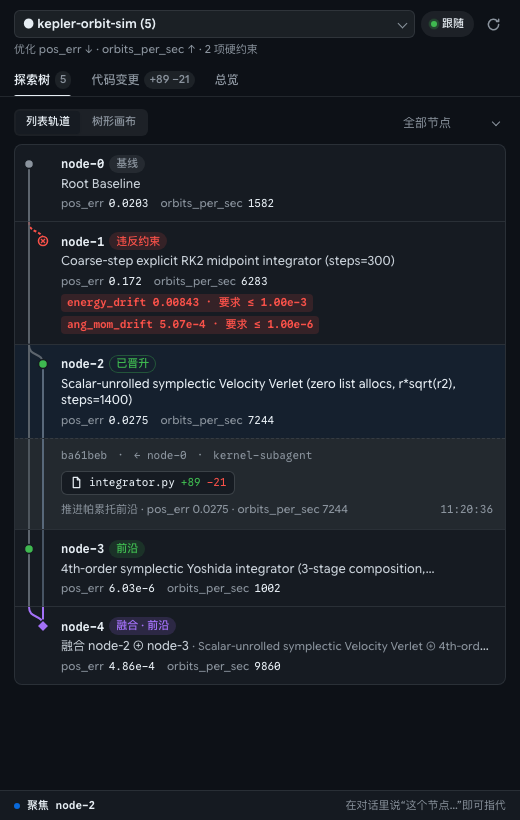

# ExpTree (`etree`)

**Git-Native Split-and-Converge Multi-Objective AutoResearch DAG Engine & Multi-Agent UI**

ExpTree turns iterative algorithm optimization and automated research into an auditable, crash-recoverable Git DAG—built to work seamlessly across **Codex**, **OpenCode**, **Pi**, **DeepSeek Harness (`dsh`)**, and **Antigravity**.

Instead of burning context windows on linear trial-and-error in a dirty working tree, ExpTree isolates every hypothesis in a physical `git worktree`, preserves failed experiments as inspectable commits for targeted retries, filters candidates through hard scientific constraints and multi-objective Pareto selection, and semantically converges complementary branches `N-to-1`.

---

## Core Capabilities

- **Git-Native DAG + Worktree Isolation**: Stores experiment state inside `.git/exp-tree/state.json` (never pollutes `git status` or gets wiped by `git reset --hard`) with `syscall.Flock` cross-process locking and isolated `.git/exp-tree/worktrees/<node-id>` sandboxes.
- **Preserved Failed Commits & Retry Branching**: Broken, regressed, or constraint-violating experiments are committed onto `exp/<node-id>` before restoring a clean parent workspace—letting agents inspect exact red/green diffs and fork bug-fix retries directly from `PRUNED` nodes.
- **Hard Constraint Gates + Multi-Objective Pareto Frontier**: Enforces non-negotiable domain invariants (`energy_drift<=0.001,ang_mom_drift<=1e-6`) with one-vote veto, computes the non-dominated Pareto front across competing objectives (`pos_err:min,orbits_per_sec:max`), and identifies the normalized Utopia Knee winner.
- **N-to-1 Semantic Convergence (`etree converge`)**: Uses 3-way Git merge as a structural pre-probe; when competing optimizations touch the same hot loop, rolls back to a clean anchor and compiles each parent's diff + hypothesis brief for semantic synthesis.
- **Prior-Art Novelty Gate**: Built-in workflow protocol separating *Known SOTA Baselines* (`node-0`) from *Novel Exploratory Hypotheses* via mandatory prior-art checks before spawning parallel workers.
- **Session Isolation & Crash Recovery (`etree resume`)**: Per-session bindings (`ETREE_SESSION_ID`, `ANTIGRAVITY_CONVERSATION_ID`, `CODEX_THREAD_ID`, `OPENCODE_SESSION_ID`, `PI_SESSION_ID`, `DSH_SESSION_ID`) prevent UI/focus leakage across concurrent sessions, while `etree resume` probes worker PIDs to finish or cleanly prune orphaned runs.

---

## Visual Console (Standalone `etree serve` & Antigravity Sidecar)

Both the embedded standalone HTTP server (`etree serve`) and the Antigravity native Sidecar share the exact same lightweight UI (list metro-rail view, draggable left-to-right tree canvas, 2D Pareto frontier scatter chart, and word-level GitHub-style diffs):

| Metro Rail & Lineage Spotlight | Left-to-Right DAG Canvas | Multi-Objective Pareto Frontier |
| --- | --- | --- |
|  |  |  |

---

## Multi-Backend Support Matrix

ExpTree works bidirectionally: any MCP/CLI-capable agent can **drive** `etree`, and `etree`'s coordinator (`internal/orchestrator`) can also **spawn** multiple agent backends in parallel worktrees.

| Agent Backend | Integration Surface | Worker / Supervisor Driver | Session Env Auto-Detect | Setup Guide |
| --- | --- | --- | --- | --- |
| **Codex** | MCP (`etree mcp`) + CLI + `AGENTS.md` + `skills/` | `codex exec --full-auto` | `CODEX_THREAD_ID` | `etree setup codex` |
| **OpenCode** | MCP + Plugin Hook (`adapters/opencode`) + `skills/` | `opencode run` | `OPENCODE_SESSION_ID` | `etree setup opencode` |
| **Pi** | Native Extension (`adapters/pi`) + `etree serve` statusbar | `pi -p` | `PI_SESSION_ID` | `etree setup pi` |
| **DeepSeek Harness (`dsh`)** | YAML Overlay Patch (`adapters/dsh/exp-tree.yml`) + Hooks | `dsh headless` | `DSH_SESSION_ID` | `etree setup dsh` |
| **Antigravity IDE** | Native Sidecar Plugin + `exp-scout` / `exp-worker` / `exp-synthesizer` | Hub-and-Spoke `invoke_subagent` | `ANTIGRAVITY_CONVERSATION_ID` | `etree setup antigravity` |

---

## Quick Start (3 Steps)

### 1. Build & Install `etree`
Requires Go 1.17+ and Git:
```bash
git clone https://github.com/your-org/exp-tree.git
cd exp-tree
./scripts/install.sh
```
This compiles `etree` (`CGO_ENABLED=0`) and installs it to `~/.local/bin/etree`.

### 2. Run the 10-Second Multi-Objective Pareto Demo
```bash
./examples/run_pareto_demo.sh
```
This spins up a self-contained Kepler orbital integration benchmark (`pos_err:min,orbits_per_sec:max` subject to `energy_drift<=0.001,ang_mom_drift<=1e-6`), demonstrates constraint-gate pruning (`node-1`), discovers two Pareto vertices (`node-2`, `node-3`), and converges them `N-to-1` (`node-4`).

Inspect the resulting DAG, Pareto chart, and preserved failure diff in your browser:
```bash
etree serve -repo examples/pareto_workspace -addr 127.0.0.1:7421
```

### 3. Connect Your Coding Agent Backend
Run `etree setup <backend>` to print ready-to-paste configuration for your agent:
```bash
etree setup codex
etree setup opencode
etree setup pi
etree setup dsh
etree setup antigravity
```
Then load the universal workflow skill at [`skills/autoresearch-tree/SKILL.md`](skills/autoresearch-tree/SKILL.md) (or the full Hub-and-Spoke multi-subagent plugin under [`adapters/antigravity/`](adapters/antigravity/)).

---

## CLI & MCP Reference

### CLI Commands
```bash
# 1. Optional immediate placeholder (marks node-0 EXPLORING before slow baseline prep)
etree init -repo <DIR> -goal "<topic>" -has-baseline=false

# 2. Initialize / finalize baseline with multi-objective specs & hard constraints
etree up -repo <DIR> -goal "<goal>" \
  -objectives "pos_err:min,orbits_per_sec:max" \
  -constraints "energy_drift<=0.001,ang_mom_drift<=1e-6" \
  -eval-cmd "python3 bench.py" -serve=false

# 3. Fork an isolated worktree branch (also works from PRUNED nodes for bug-fix retries)
etree branch -repo <DIR> -parent node-0 -agent codex -hypothesis "<mechanism>" -worktree

# 4. Evaluate objectively (commits promoted changes, or saves failed snapshot & resets clean parent)
etree eval -repo <DIR> -node <node-id> -cmd "python3 bench.py" -rollback=true

# 5. Converge 2+ Pareto / validated branches semantically
etree converge -repo <DIR> -parents node-2,node-3 -supervisor codex

# 6. Read structured tree brief, UCB1 expansion recommendation, or reconcile crashed orphans
etree brief -repo <DIR>
etree recommend -repo <DIR>
etree resume -repo <DIR>

# 7. Bind / inspect session focus or launch standalone Web UI
etree bind -repo <DIR> | etree bind -unbind | etree focus
etree serve -repo <DIR> -addr 127.0.0.1:7421
```

### MCP Server (`etree mcp`)
Exposes 6 JSON-RPC 2.0 tools over stdio (`etree_init`, `etree_brief`, `etree_branch`, `etree_eval`, `etree_converge`, `etree_recommend`).

---

## Repository Layout
```
exp-tree/
├── cmd/etree/                  # CLI entrypoint + setup generator
├── internal/
│   ├── tree/                   # Thread/process-safe DAG engine, Pareto math, session focus bindings
│   ├── eval/                   # Auto/JSON/GoBench/Regex graders + commit-preserving rollback runner
│   ├── crossover/              # 3-way merge conflict prober + N-to-1 supervisor synthesis brief
│   ├── orchestrator/           # Bounded parallel worktree scheduler, backend drivers, PID orphan resume
│   ├── gitops/                 # .git/exp-tree/ snapshot, diff, and worktree primitives
│   ├── mcp/                    # Stdio MCP server
│   ├── server/ & internal/webui/ # Embedded HTTP API & zero-dependency Web UI
│   └── metabench/              # Deterministic A/B tree-search vs linear-search benchmark suite
├── skills/autoresearch-tree/   # Backend-agnostic AutoResearch Skill
├── adapters/
│   ├── codex/                  # Codex MCP config & AGENTS.md template
│   ├── opencode/               # OpenCode plugin hook + opencode.json example
│   ├── pi/                     # Pi extension with auto-daemon & footer status
│   ├── dsh/                    # DeepSeek Harness YAML patch + plugin hook
│   └── antigravity/            # Full Antigravity IDE Sidecar UI + subagent definitions
├── examples/                   # Reproducible demo scripts (basic, synergy, multi-objective Pareto)
└── scripts/install.sh          # One-command build & local installation
```

## License
[MIT](LICENSE)
