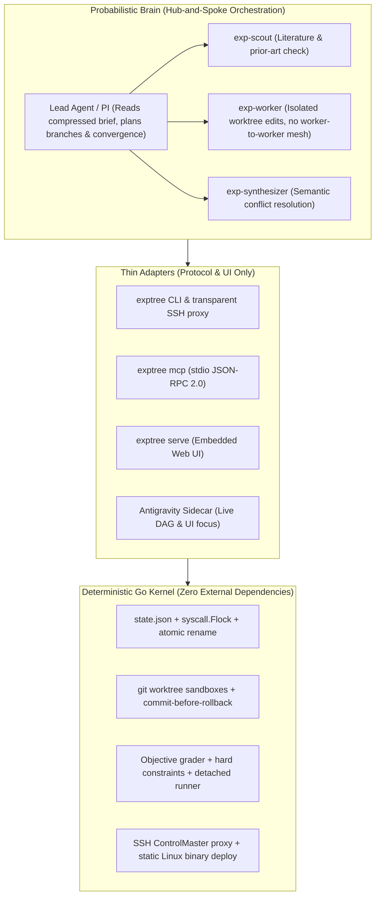
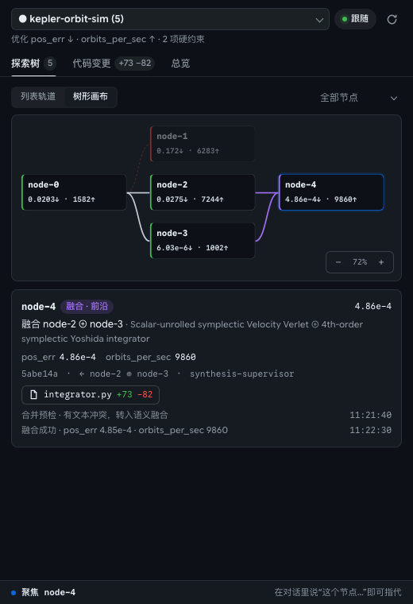

# ExpTree (`exptree`)

**A Git-native experiment orchestration harness for long-running algorithmic and scientific research.**

ExpTree turns iterative algorithm and systems optimization into an auditable, crash-recoverable Git DAG—built to run across **Codex**, **OpenCode**, **Pi**, **DeepSeek Harness (`dsh`)**, and **Antigravity IDE** (`/exptree`). It ships as a **zero-dependency Go static binary** (`go.mod` has 0 external packages) exposing a unified **CLI**, **stdio MCP server**, **embedded Web UI**, and **IDE Sidecar plugin**.

Instead of burning context windows on linear trial-and-error inside a dirty working directory, ExpTree isolates every hypothesis in a physical `git worktree`, commits failed experiments before rolling back so agents can inspect diffs and retry, gates candidates with hard domain invariants and multi-objective trade-offs, and supports multi-hour detached runs on local machines or remote SSH/GPU servers.

---

## Why ExpTree?

| Approach | Branching & Isolation | Failed Experiments | Long-Term Context | Multi-Hour / Cluster Evals | Remote Compute |
| --- | --- | --- | --- | --- | --- |
| **Linear Coding Agents** | Single dirty working tree; overwrites history | Overwritten or discarded; easy to repeat mistakes | Logs & diffs accumulate until context rots | Blocked on short shell timeouts | Manual SSH loops or copying files |
| **Single-Chain AutoResearch Scripts** | Greedy hill-climbing; one "best" path only | Dropped on failure; cannot combine two strengths | Relies on prompt memory or ad-hoc markdown | Tied to synchronous single-script loop | Single-machine focused |
| **Experiment Trackers (MLflow / W&B)** | Post-hoc metric logging; no code sandboxing | Logs numbers, not isolated retryable worktrees | Built for humans, not live agent steering | External job logging only | Centralized server required |
| **Mesh Multi-Agent Frameworks** | Worker-to-worker chatter causes drift & token bloat | Shared state frequently gets out of sync | Prompt-managed state causes ledger hallucinations | No OS-level PID tracking or orphan recovery | Custom RPC scaffolding needed |
| **ExpTree (`exptree`)** | **Git DAG + isolated `git worktree` per node (`N`-way fork & `N-to-1` merge)** | **Committed onto `exp/<node-id>` before `reset --hard` for diff inspection & retry** | **Externalized `.git/exp-tree/state.json` + compressed `brief` & 3-part capsules** | **Unlimited `-timeout 0`, `Setsid` `-detach`, `PROGRESS:` streaming, `signal 0` recovery** | **Single static binary via `exptree deploy -ssh`; zero-config SSH proxy + offline cache** |

---

## Architecture & Core Design Principles

ExpTree cleanly separates **what the LLM decides** from **what deterministic code guarantees**:



### Four Engineering Principles

1. **Git + DAG as the Single Source of Truth**:
   Experiment state lives in `.git/exp-tree/state.json`, never in the tracked working tree—so `git status` stays clean and `git reset --hard` never wipes experiment history. Parallel writes are protected by OS file locks (`syscall.Flock`) and atomic temp-file renames. Every broken or regressed experiment is committed to `exp/<node-id>` **before** restoring a clean parent workspace, turning failed runs into inspectable diff history rather than lost work.
2. **Deterministic Kernel vs. Probabilistic Brain**:
   LLMs are good at reading literature, proposing hypotheses, and writing code, and unreliable at bookkeeping, concurrency, and grading. ExpTree moves directory isolation, cross-process locking, objective metric parsing, hard-constraint enforcement, multi-objective dominance checks, and PID lifecycle tracking into deterministic Go code. Workers never chat in a mesh; they execute one hypothesis in isolation and report back to the coordinator.
3. **Externalized Memory Against Context Rot**:
   Because full state stays on disk, conversations can be restarted or truncated without losing progress. The coordinator reads high-density tree summaries (`exptree brief`), drills into single nodes only when debugging (`exptree view`), and dispatches `exp-worker` subagents with focused 3-part capsules (goal + parent metrics + single assigned hypothesis).
4. **Zero-Dependency Static Go Kernel for Compute Locality**:
   Scientific solvers, compilers, and multi-GB datasets usually live on remote Linux/GPU servers where Python/conda environments break or lack internet access. Compiling the kernel with `CGO_ENABLED=0` produces a single ~8 MB static binary with zero third-party Go dependencies ([`go.mod`](go.mod)), cross-compiled for Linux `amd64`/`arm64` so you can deploy straight to a remote host and keep compute next to the data.

---

## Visual Console

Both the embedded standalone HTTP server (`exptree serve`) and the Antigravity Sidecar share the exact same lightweight interface: a structured list & lineage rail, an interactive left-to-right DAG canvas, a 2D multi-objective trade-off chart, and GitHub-style diffs.

| List & Lineage Rail | Left-to-Right DAG Canvas | Multi-Objective Trade-off Chart |
| --- | --- | --- |
|  |  |  |

---

## Built for Real Research Workflows

- **Scientific Readiness Gate**: Does not rush to scaffold toy code on Turn 1 when you are still surveying papers or framing the problem. Checks three prerequisites first: agreed research direction, real codebase/baseline (`node-0`), and clear benchmark + runtime budget.
- **Prior-Art Novelty Gate**: Separates reproducing known published baselines (`node-0`) from exploratory hypotheses by running read-only literature/codebase checks (`exp-scout`) before dispatching parallel workers.
- **Multi-Hour & Cluster Evaluations**:
  - Defaults to unlimited evaluation time (`-timeout 0`) so 3-hour solver or training benchmarks are never killed prematurely.
  - Supports `-detach` to launch evaluations in a detached OS session (`Setsid`), streaming `PROGRESS:` lines to update node progress in-place without bloating `state.json`.
  - Supports external Slurm/cluster workflows via `exptree step` (live status updates) and `exptree record` (backfill metrics from files or flags).
  - Recovers cleanly across restarts with `exptree resume`, probing active worker PIDs via `signal 0`.
- **N-to-1 Branch Convergence (`exptree converge`)**: Attempts a 3-way Git merge first; if competing optimizations modify the same hot path, aborts cleanly and compiles each parent's diff and hypothesis into a synthesis brief for `exp-synthesizer`.
- **Per-Session Isolation**: Isolates active tree bindings per conversation/thread (`ANTIGRAVITY_CONVERSATION_ID`, `CODEX_THREAD_ID`, `OPENCODE_SESSION_ID`, `PI_SESSION_ID`, `DSH_SESSION_ID`, `ETREE_SESSION_ID`).

---

## Quick Start (3 Steps)

### 1. Build & Install `exptree`
Requires Go 1.17+ and Git:
```bash
git clone https://github.com/Sarment/exp-tree.git
cd exp-tree
./scripts/install.sh
```
This compiles `exptree` (`CGO_ENABLED=0`), installs `~/.local/bin/exptree` (with compatibility symlink `~/.local/bin/etree`), and pre-builds cached static Linux `amd64` and `arm64` binaries under `~/.local/share/exptree/` for instant remote deployment.

### 2. Run the 10-Second Multi-Objective Demo
```bash
./examples/run_pareto_demo.sh
```
This creates a self-contained Kepler orbital integration benchmark (`pos_err:min,orbits_per_sec:max` subject to `energy_drift<=0.001,ang_mom_drift<=1e-6`), demonstrates constraint pruning (`node-1`), discovers two trade-off leaders (`node-2`, `node-3`), and merges them (`node-4`).

Inspect the resulting DAG, trade-off chart, and preserved failure diff in your browser:
```bash
exptree serve -repo examples/pareto_workspace -addr 127.0.0.1:7421
```

### 3. Connect Your Coding Agent Backend
Run `exptree setup <backend>` to print ready-to-paste configuration (or remote deployment hints):
```bash
exptree setup codex
exptree setup opencode
exptree setup pi
exptree setup dsh
exptree setup antigravity
exptree setup remote
```
Then load [`skills/exptree/SKILL.md`](skills/exptree/SKILL.md) (or invoke `/exptree` in Antigravity with the full multi-agent plugin under [`adapters/antigravity/`](adapters/antigravity/)).

---

## Multi-Backend Support Matrix

ExpTree works bidirectionally: any MCP/CLI-capable agent can **drive** `exptree`, and `exptree`'s coordinator (`internal/orchestrator`) can also **spawn** worker backends in parallel worktrees.

| Agent Backend | Integration Surface | Worker / Supervisor Driver | Session Env Auto-Detect | Setup Guide |
| --- | --- | --- | --- | --- |
| **Codex** | MCP (`exptree mcp`) + CLI + `AGENTS.md` + `skills/` | `codex exec --full-auto` | `CODEX_THREAD_ID` | `exptree setup codex` |
| **OpenCode** | MCP + Plugin Hook (`adapters/opencode`) + `skills/` | `opencode run` | `OPENCODE_SESSION_ID` | `exptree setup opencode` |
| **Pi** | Native Extension (`adapters/pi`) + `/exptree` + `exptree serve` | `pi -p` | `PI_SESSION_ID` | `exptree setup pi` |
| **DeepSeek Harness (`dsh`)** | YAML Overlay Patch (`adapters/dsh/exptree.yml`) + Hooks | `dsh headless` | `DSH_SESSION_ID` | `exptree setup dsh` |
| **Antigravity IDE** | Native Sidecar Plugin + `/exptree` + `exp-scout` / `exp-worker` / `exp-synthesizer` | Hub-and-Spoke `invoke_subagent` | `ANTIGRAVITY_CONVERSATION_ID` | `exptree setup antigravity` |

---

## Remote SSH / GPU Server Workflow

When your codebase, solvers, and compute stay on a remote Linux/GPU host (e.g. `gpu-a100:/data/exp/proj`) while your IDE runs locally:

| Plane | Where It Lives | Responsibility |
| --- | --- | --- |
| **Remote Server (Source of Truth)** | `gpu-a100:/data/exp/proj` | Runs `exptree` CLI/MCP, holds Git commits, worktrees, and `.git/exp-tree/state.json` |
| **Local Anchor** | `.exptree_bindings/<convId>.json` | Stores `mode: "remote"` with SSH host, optional HTTP URL, and local UI focus |
| **Offline Cache** | `.exptree_cache/<convId>.json` | Read-only local snapshot updated on every poll; keeps DAG viewable when offline |

1. **Auto-deploy `exptree` over SSH (zero remote toolchain required)**:
   ```bash
   exptree deploy -ssh gpu-a100
   ```
   Probes remote OS/arch, transfers the matching static binary from `~/.local/share/exptree/` over a persistent `SSH ControlMaster` socket, and skips transfer if the version already matches.
2. **Option A — Zero-Daemon Direct SSH (Recommended)**:
   ```bash
   ssh gpu-a100 "cd /data/exp/proj && ~/.local/bin/exptree init -goal '<goal>' -has-baseline=false"
   exptree bind -ssh gpu-a100 -repo /data/exp/proj
   ```
   Once bound with `-ssh`, local commands (`brief`, `view`, `recommend`, `branch`, `eval`, `step`, `record`, `converge`, `resume`) automatically proxy to `gpu-a100:/data/exp/proj` and prepend the node currently selected in your local sidebar.
3. **Option B — Real-Time HTTP Proxy over SSH Tunnel**:
   ```bash
   ssh gpu-a100 "~/.local/bin/exptree serve -repo /data/exp/proj -addr 127.0.0.1:7421"
   ssh -fNL 17421:127.0.0.1:7421 gpu-a100
   exptree bind -remote http://127.0.0.1:17421 -ssh gpu-a100 -repo /data/exp/proj
   ```

---

## CLI & MCP Reference

### CLI Commands
```bash
# 1. Optional placeholder before slow baseline prep (marks node-0 EXPLORING)
exptree init -repo <DIR> -goal "<topic>" -has-baseline=false

# 2. Initialize / finalize baseline with objectives & hard constraints
exptree up -repo <DIR> -goal "<goal>" \
  -objectives "pos_err:min,orbits_per_sec:max" \
  -constraints "energy_drift<=0.001,ang_mom_drift<=1e-6" \
  -eval-cmd "python3 bench.py" -serve=false

# 3. Fork an isolated worktree branch (also works from PRUNED nodes for retries)
exptree branch -repo <DIR> -parent node-0 -agent codex -hypothesis "<mechanism>" -worktree

# 4. Evaluate objectively (-timeout 0 unlimited by default; -detach for multi-hour runs)
exptree eval -repo <DIR> -node <node-id> -cmd "python3 bench.py" -rollback=true
exptree eval -repo <DIR> -node <node-id> -cmd "<long-running-cmd>" -detach

# 5. Stream live progress or record results from external cluster / Slurm jobs
exptree step -repo <DIR> -node <node-id> -msg "120/1000 solved=96"
exptree record -repo <DIR> -node <node-id> -from-file <log>   # or -metrics "solved=96,conflicts=0"

# 6. Converge 2+ leading / validated branches N-to-1
exptree converge -repo <DIR> -parents node-2,node-3 -supervisor codex

# 7. Read structured tree brief, node details, expansion hints, or recover orphaned PIDs
exptree brief -repo <DIR>
exptree view -repo <DIR> -node <node-id>
exptree recommend -repo <DIR>
exptree resume -repo <DIR>

# 8. Deploy to SSH host, bind local/remote session focus, or run standalone Web UI
exptree deploy -ssh <host>
exptree bind -repo <DIR>
exptree bind -ssh <host> -repo /data/exp/proj
exptree bind -unbind | exptree focus
exptree serve -repo <DIR> -addr 127.0.0.1:7421
exptree version
```

### MCP Server (`exptree mcp`)
Exposes 6 JSON-RPC 2.0 tools over stdio: `etree_init`, `etree_brief`, `etree_branch`, `etree_eval`, `etree_converge`, and `etree_recommend`.

---

## Repository Layout

```
exptree/
├── cmd/exptree/                # CLI entrypoint, remote SSH proxy/deploy, backend setup generator
├── internal/
│   ├── tree/                   # Process-safe DAG engine, multi-objective selection, session focus
│   ├── eval/                   # Auto/JSON/GoBench/Regex graders + commit-preserving rollback runner
│   ├── crossover/              # 3-way merge conflict prober + N-to-1 synthesis brief generator
│   ├── orchestrator/           # Bounded parallel worktree scheduler, backend drivers, PID orphan resume
│   ├── gitops/                 # .git/exp-tree/ snapshot, diff, and worktree primitives
│   ├── mcp/                    # Stdio MCP server
│   ├── server/ & internal/webui/ # Embedded HTTP API & zero-dependency Web UI
│   └── metabench/              # Deterministic A/B tree-search vs linear-search benchmark suite
├── skills/exptree/             # Backend-agnostic /exptree workflow skill
├── adapters/
│   ├── codex/                  # Codex MCP config & AGENTS.md template
│   ├── opencode/               # OpenCode plugin hook + config example
│   ├── pi/                     # Pi extension with auto-daemon, /exptree & footer status
│   ├── dsh/                    # DeepSeek Harness YAML overlay (`exptree.yml`) + hook
│   └── antigravity/            # Antigravity IDE Sidecar UI, `/exptree` skill, rules & subagents
├── examples/                   # Reproducible demo scripts (basic, synergy, multi-objective)
└── scripts/install.sh          # One-command static build, local install & Linux cross-compile cache
```

## License
[MIT](LICENSE)
