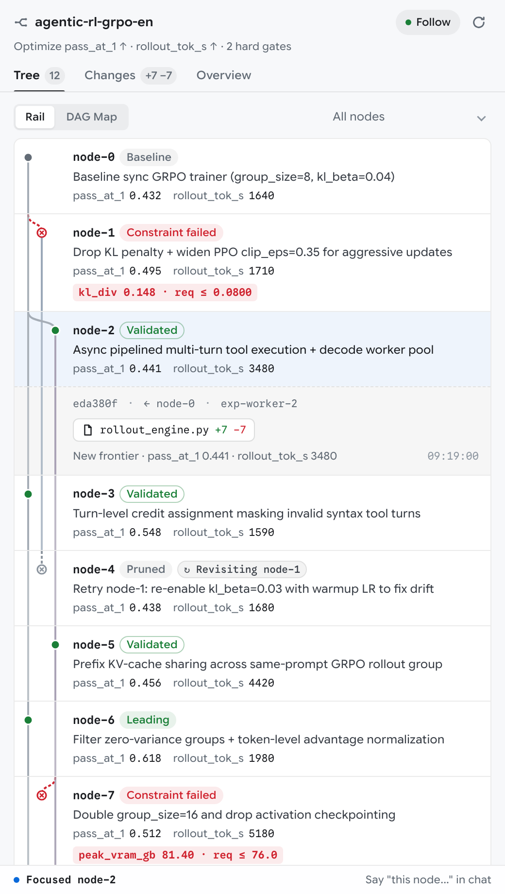
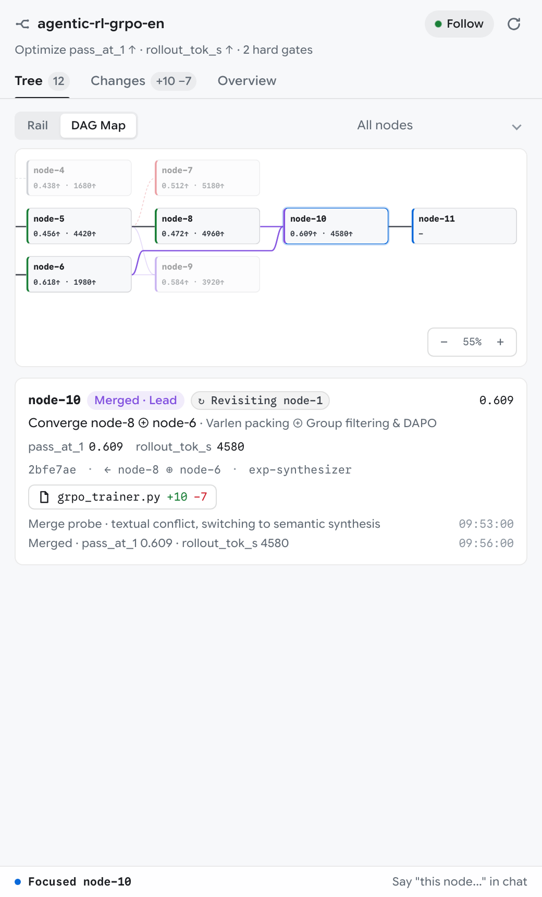
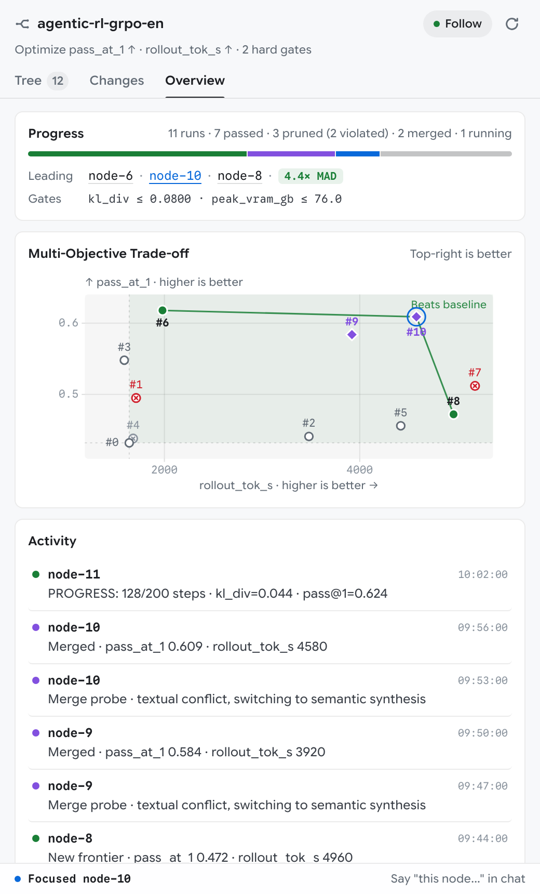
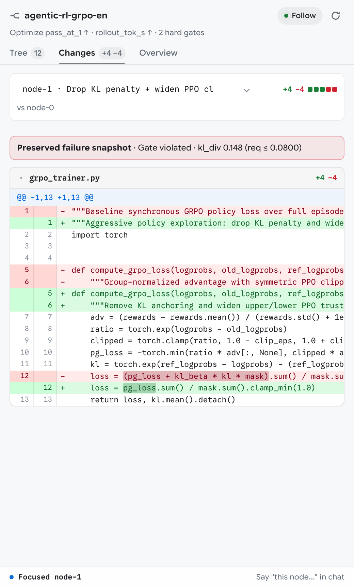
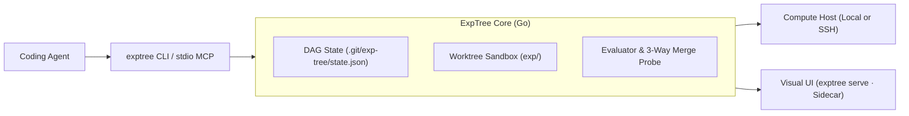

# ExpTree (`exptree`)

English | [简体中文](README.zh-CN.md)

**A Git-native experiment workspace and visual DAG console for coding agents running iterative algorithmic and ML optimization.**

Works with **Codex**, **OpenCode**, **Pi**, **DeepSeek Harness (`dsh`)**, and **Antigravity IDE** (`/exptree`) as a single static Go binary exposing a **CLI**, **stdio MCP server**, **embedded Web UI**, and **IDE Sidecar plugin** (bilingual UI via `?lang=en` / `?lang=zh`).

> *"Optimize our multi-turn GRPO agent trainer under `/data/exp/agentic-rl` on `ssh gpu-a100`: survey recent rollout/clipping recipes first, then explore parallel candidates while keeping KL divergence ≤ 0.08 and peak VRAM ≤ 76 GB."*

| List & Lineage Rail (12 Nodes) | Left-to-Right DAG Canvas |
| --- | --- |
|  |  |
| **Overview, Confidence & Trade-off Chart** | **Preserved Failure Diff & Constraint Gate** |
|  |  |

**12-node Multi-Turn GRPO (`agentic-rl-grpo`) run shown above**:
- **Constraint veto & preserved failure diff (`node-0` → `node-1` / `node-7`)**: Dropping KL regularization (`node-1`, `kl_div=0.148 > 0.08`) and disabling activation checkpointing at `G=16` (`node-7`, `81.4 GB > 76 GB`) are flagged `PRUNED` while keeping full diffs inspectable in **Changes**.
- **Assumption-changed revisits (`node-4`, `node-10`)**: `node-4` retries `node-1` directly to restore KL stability, and converged branch `node-10` revisits (`↻`) `node-1`'s aggressive clipping insight safely inside a KL-regularized asymmetric trust region (`clip_high=0.28`).
- **Parallel depth exploration (`node-2` → `node-5` → `node-8`, `node-3` → `node-6`)**: Prefix KV-cache sharing / varlen FlashAttn packing (`rollout_tok_s=4960`) and turn-level credit / zero-variance group filtering (`pass@1=0.618`) advance independently in separate worktrees.
- **N-to-1 convergence & live long eval (`node-9`, `node-10`, `node-11`)**: `node-10` merges varlen packing with group filtering (`pass@1=0.609`, `4580 tok/s`, `4.4× MAD` above run-to-run noise), while `node-11` streams live `PROGRESS: 128/200 steps` updates inside Overview.

---

## Quick Start

### Option A — Let Your Coding Agent Install It

Paste this prompt into Codex, OpenCode, Pi, or Antigravity:

```text
Read https://github.com/Sarment/exp-tree and install exptree locally (plus configure this agent backend via `exptree setup`).
```

### Option B — 3-Step Manual Install & 10-Second Demo

Requires Go 1.17+ and Git:

```bash
git clone https://github.com/Sarment/exp-tree.git
cd exp-tree
./scripts/install.sh
```

This compiles `exptree` (`CGO_ENABLED=0`), installs `~/.local/bin/exptree` (with compatibility symlink `~/.local/bin/etree`), and pre-builds cached static Linux `amd64`/`arm64` binaries under `~/.local/share/exptree/` for SSH deployment.

Run the included self-contained multi-objective demo and inspect the Web UI in your browser:

```bash
./examples/run_pareto_demo.sh
exptree serve -repo examples/pareto_workspace -addr 127.0.0.1:7421
```

Print integration config for your agent backend:

```bash
exptree setup codex       # also: opencode | pi | dsh | antigravity | remote
```

Load [`skills/exptree/SKILL.md`](skills/exptree/SKILL.md) (or invoke `/exptree` in Antigravity with the plugin under [`adapters/antigravity/`](adapters/antigravity/)).

---

## What It Solves & Core Capabilities

In multi-round optimization with coding agents, practical bottlenecks appear quickly after the first few iterations:
- You want to look back at an earlier failed branch, see the exact code diff and failure reason, or fork a fix directly from it without excavating terminal logs.
- You are running multiple optimization ideas concurrently and want one board comparing metrics, constraint breaches, statistical confidence, and lineage instead of scattered files and tabs.
- Several rounds later, it is easy to forget *why* the agent changed a training loss or rollout kernel—each node binds hypothesis, step log, Git diff, and evaluation metrics together.
- When real evaluations run for hours on a remote Linux/GPU host, polling logs via ad-hoc SSH commands becomes tedious; the board keeps remote execution centralized with an offline read-only local cache.

Under the dashboard, ExpTree provides a concrete Git and evaluation harness:

- **Hidden DAG State & Isolated Worktrees**: Stores state in `.git/exp-tree/state.json` outside tracked files so `git status` stays clean and survives `git reset --hard`. Concurrent updates synchronize via `syscall.Flock` and atomic renames; each branch edits inside `.git/exp-tree/worktrees/<node-id>`.
- **Preserved Failure Commits, Revisits & Retry Branching**: Failed, regressed, or constraint-violating experiments are committed onto `exp/<node-id>` before restoring a clean workspace. Agents can inspect failure diffs, fork fixes directly (`branch -parent <pruned-node>`), and tag retries when an earlier assumption changes (`branch -revisits <pruned-node>`).
- **Hard Constraints, MAD Confidence & Anti-Thrash Guard**: Enforces domain invariants (`kl_div<=0.08, peak_vram_gb<=76`) separately from competing objectives (`pass_at_1:max, rollout_tok_s:max`). `brief` and Overview track improvement vs. run-to-run variance using Median Absolute Deviation (`N× MAD`) and warn after 3+ consecutive pruned runs.
- **N-to-1 Convergence & Winner Finalization**: `exptree converge` runs a 3-way Git merge probe first; on overlapping edits, it aborts cleanly, compiles parent diffs for semantic synthesis, and always re-evaluates the merged code. `exptree finalize` exports a clean branch (`exptree/winner-<id>`) with a PR-ready diff and metric summary.
- **Multi-Hour & Remote Compute Support**: Unlimited default eval timeout (`-timeout 0`), detached `Setsid` sessions (`-detach`) with in-place `PROGRESS:` streaming, external cluster backfill (`step`/`record`), PID liveness reconciliation (`signal 0`), and single-binary SSH deployment (`exptree deploy -ssh <host>`).

**When to use / when not needed**:
- **Good fit**: Agentic RL / ML training loops, CUDA/rollout kernels, compiler passes, or systems benchmarks where multiple branches run against objective metrics over hours or days.
- **Not needed**: Standard CRUD feature work, one-off bug fixes, or small edits where single-turn verification is already enough.

---

## Multi-Backend Support

Host Coding Agents schedule subagents and drive `exptree` via CLI or MCP; `exptree` manages shared state, `git worktree` isolation, objective evaluation, and optional `exptree converge -supervisor <backend>` conflict synthesis.

| Agent Backend | Integration Surface | Converge Supervisor Driver | Session Env Auto-Detect | Setup Command |
| --- | --- | --- | --- | --- |
| **Codex** | MCP (`exptree mcp`) + CLI + `AGENTS.md` + `skills/` | `codex exec --full-auto` | `CODEX_THREAD_ID` | `exptree setup codex` |
| **OpenCode** | MCP + Plugin Hook (`adapters/opencode`) + `skills/` | `opencode run` | `OPENCODE_SESSION_ID` | `exptree setup opencode` |
| **Pi** | Native Extension (`adapters/pi`) + `/exptree` + `exptree serve` | `pi -p` | `PI_SESSION_ID` | `exptree setup pi` |
| **DeepSeek Harness (`dsh`)** | YAML Overlay (`adapters/dsh/exptree.yml`) + Hooks | `dsh headless` | `DSH_SESSION_ID` | `exptree setup dsh` |
| **Antigravity IDE** | Native Sidecar Plugin + `/exptree` + `exp-scout` / `exp-worker` / `exp-synthesizer` | `exp-synthesizer` (host `invoke_subagent`) | `ANTIGRAVITY_CONVERSATION_ID` | `exptree setup antigravity` |

---

## Remote SSH / GPU Server Workflow

Keep your codebase, training checkpoints, and GPU compute on a remote Linux host (`gpu-a100:/data/exp/proj`) while viewing and steering experiments from your local IDE:

| Plane | Location | Responsibility |
| --- | --- | --- |
| **Remote Server (Source of Truth)** | `gpu-a100:/data/exp/proj` | Runs `exptree` CLI/MCP, holds Git commits, worktrees, and `.git/exp-tree/state.json` |
| **Local Anchor** | `.exptree_bindings/<convId>.json` | Stores `mode: "remote"`, SSH host, optional HTTP URL, and local UI focus |
| **Offline Cache** | `.exptree_cache/<convId>.json` | Read-only local mirror refreshed on poll; keeps the DAG browsable offline |

1. **Deploy the static binary over SSH (no remote Go toolchain required)**:
   ```bash
   exptree deploy -ssh gpu-a100
   ```
   Probes remote OS/arch, transfers the matching static binary from `~/.local/share/exptree/` over a persistent `SSH ControlMaster` socket, and skips transfer if the version matches.
2. **Option A — Zero-Daemon Direct SSH (Recommended)**:
   ```bash
   ssh gpu-a100 "cd /data/exp/proj && ~/.local/bin/exptree init -goal '<goal>' -has-baseline=false"
   exptree bind -ssh gpu-a100 -repo /data/exp/proj
   ```
   Once bound with `-ssh`, local commands (`brief`, `view`, `recommend`, `branch`, `eval`, `step`, `record`, `converge`, `finalize`, `resume`) proxy transparently to `gpu-a100:/data/exp/proj` and prepend the node currently selected in your local sidebar.
3. **Option B — Real-Time HTTP Proxy over SSH Tunnel**:
   ```bash
   ssh gpu-a100 "~/.local/bin/exptree serve -repo /data/exp/proj -addr 127.0.0.1:7421"
   ssh -fNL 17421:127.0.0.1:7421 gpu-a100
   exptree bind -remote http://127.0.0.1:17421 -ssh gpu-a100 -repo /data/exp/proj
   ```

---

## Architecture & Workflow Guardrails



- **Scientific Readiness Gate**: Avoids scaffolding placeholder code during early paper surveys or problem framing; checks that research direction, target codebase/baseline (`node-0`), and benchmark + runtime budget are settled before branching.
- **Prior-Art Check**: Separates reproducing known baselines (`node-0`) from exploratory branches by running read-only literature and codebase checks (`exp-scout`) ahead of optimization edits.
- **Per-Session Isolation**: Isolates active tree bindings per conversation or thread (`ANTIGRAVITY_CONVERSATION_ID`, `CODEX_THREAD_ID`, `OPENCODE_SESSION_ID`, `PI_SESSION_ID`, `DSH_SESSION_ID`, `ETREE_SESSION_ID`).

---

## CLI & MCP Reference

<details>
<summary>Expand full CLI command reference and MCP tool list</summary>

### CLI Commands

```bash
# 1. Optional placeholder before slow baseline prep (marks node-0 EXPLORING)
exptree init -repo <DIR> -goal "<topic>" -has-baseline=false

# 2. Initialize / finalize baseline with objectives & hard constraints
exptree up -repo <DIR> -goal "<goal>" \
  -objectives "pass_at_1:max,rollout_tok_s:max" \
  -constraints "kl_div<=0.08,peak_vram_gb<=76" \
  -eval-cmd "python3 eval_swebench.py" -serve=false

# 3. Fork an isolated worktree branch (supports retrying PRUNED nodes & -revisits tag)
exptree branch -repo <DIR> -parent node-0 -agent codex -hypothesis "<mechanism>" -worktree
exptree branch -repo <DIR> -parent node-2 -revisits node-1 -hypothesis "<revisit>" -worktree

# 4. Evaluate objectively (-timeout 0 unlimited by default; -detach for multi-hour runs)
exptree eval -repo <DIR> -node <node-id> -cmd "python3 eval_swebench.py" -rollback=true
exptree eval -repo <DIR> -node <node-id> -cmd "<long-running-cmd>" -detach

# 5. Stream live progress or record results from external cluster / Slurm jobs
exptree step -repo <DIR> -node <node-id> -msg "128/200 steps pass@1=0.624"
exptree record -repo <DIR> -node <node-id> -from-file <log>   # or -metrics "pass_at_1=0.62,kl_div=0.04"

# 6. Converge 2+ leading / validated branches N-to-1 & finalize a PR-ready winner branch
exptree converge -repo <DIR> -parents node-8,node-6 -supervisor codex
exptree finalize -repo <DIR> [-node node-10] [-branch exptree/winner]

# 7. Read structured tree brief (MAD confidence & guards), node details, or recover orphaned PIDs
exptree brief -repo <DIR>
exptree view -repo <DIR> -node <node-id>
exptree recommend -repo <DIR>
exptree resume -repo <DIR>

# 8. Deploy to SSH host, bind local/remote session focus, or run standalone Web UI
exptree deploy -ssh <host>
exptree bind -repo <DIR>
exptree bind -ssh <host> -repo /data/exp/proj
exptree bind -unbind | exptree focus
exptree serve -repo <DIR> -addr 127.0.0.1:7421
exptree version
```

### MCP Server (`exptree mcp`)

Exposes 6 JSON-RPC 2.0 tools over stdio: `etree_init`, `etree_brief`, `etree_branch`, `etree_eval`, `etree_converge`, and `etree_recommend`.

</details>

---

## Repository Layout

```
exptree/
├── cmd/exptree/                # CLI entrypoint, finalize, remote SSH proxy/deploy, setup generator
├── internal/
│   ├── tree/                   # Process-safe DAG engine, MAD confidence & guards, multi-objective selection
│   ├── eval/                   # Auto/JSON/GoBench/Regex graders + commit-preserving rollback runner
│   ├── crossover/              # 3-way merge conflict prober + N-to-1 synthesis brief generator
│   ├── orchestrator/           # PID orphan recovery (resume), converge supervisor drivers, experimental dispatch
│   ├── gitops/                 # .git/exp-tree/ snapshot, diff, branch, and worktree primitives
│   ├── mcp/                    # Stdio MCP server
│   ├── server/ & internal/webui/ # Embedded HTTP API & bilingual Web UI
│   └── metabench/              # Synthetic simulation for unit-testing tree-search & dedup logic
├── skills/exptree/             # Backend-agnostic /exptree workflow skill
├── adapters/
│   ├── codex/                  # Codex MCP config & AGENTS.md template
│   ├── opencode/               # OpenCode plugin hook + config example
│   ├── pi/                     # Pi extension with auto-daemon, /exptree & footer status
│   ├── dsh/                    # DeepSeek Harness YAML overlay (`exptree.yml`) + hook
│   └── antigravity/            # Antigravity IDE Sidecar UI, `/exptree` skill, rules & subagents
├── examples/                   # Reproducible demo scripts (basic, synergy, multi-objective)
└── scripts/install.sh          # One-command static build, local install & Linux cross-compile cache
```

## License
[MIT](LICENSE)
