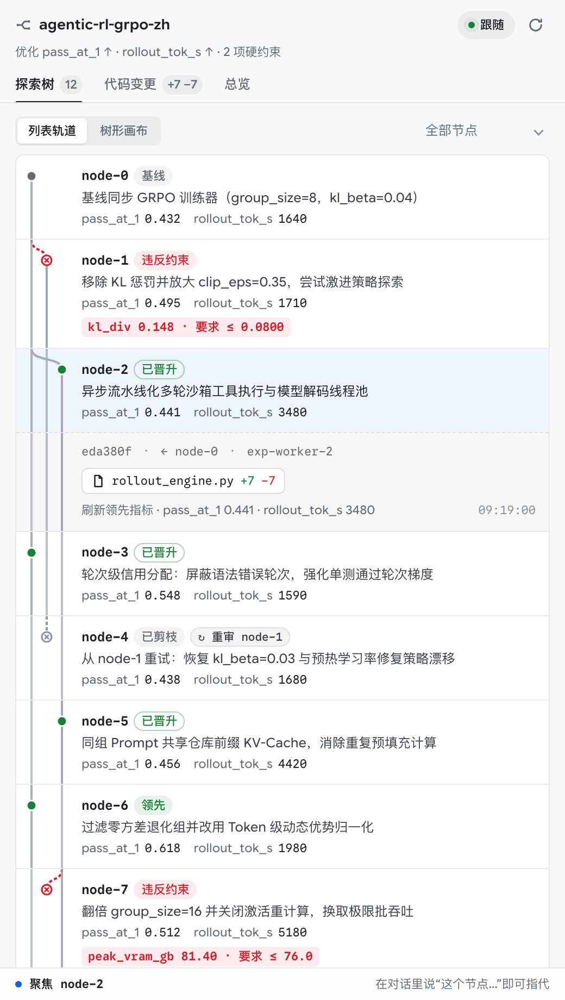
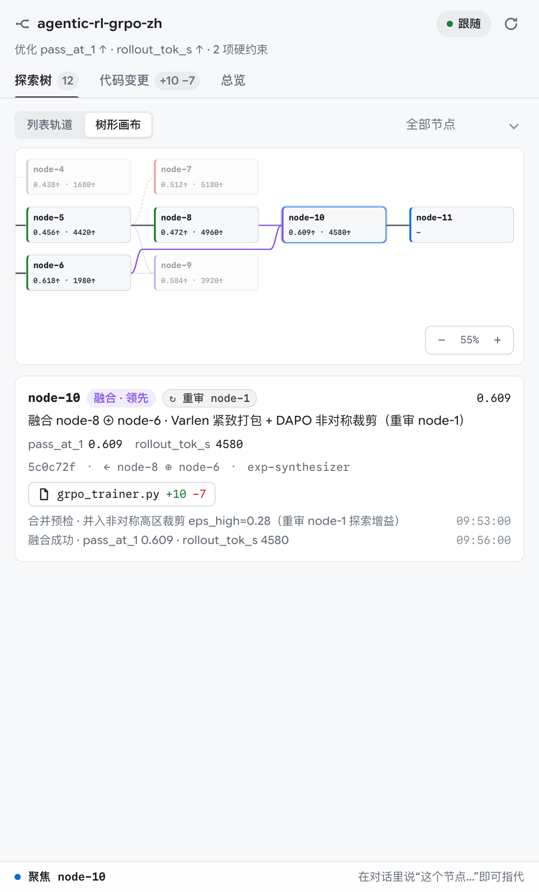
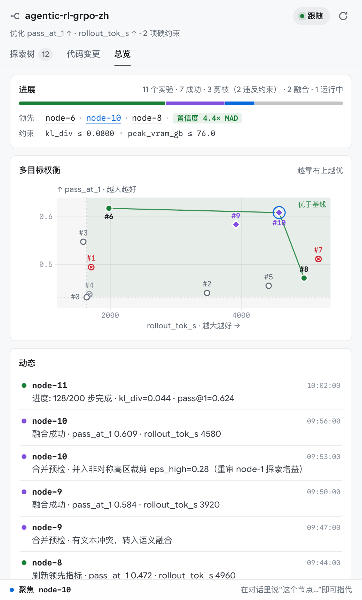
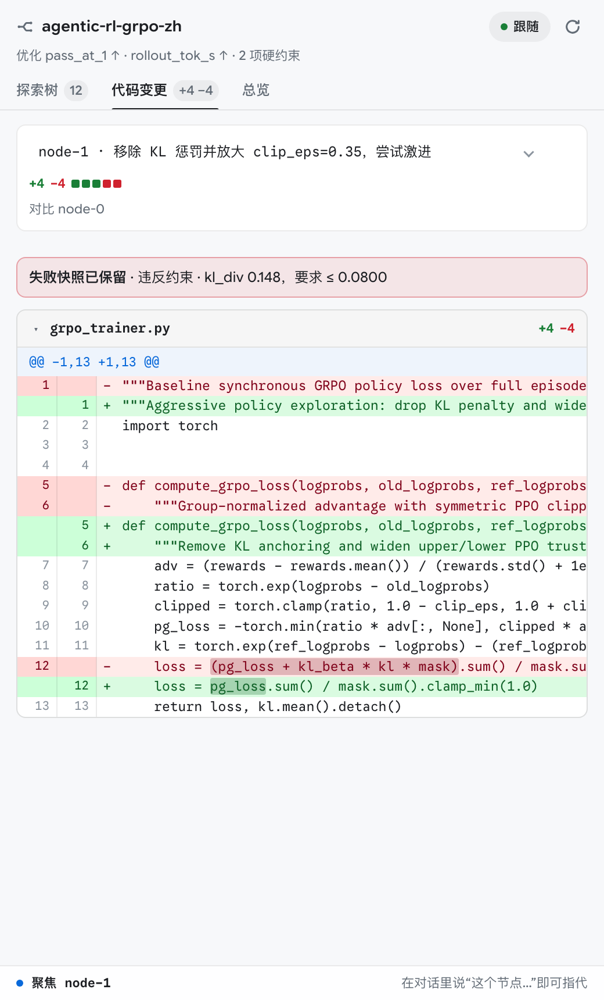
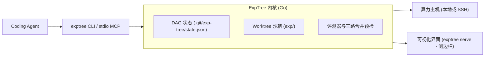

# ExpTree (`exptree`)

[English](README.md) | 简体中文

**面向长周期算法调优与 ML/科研探索的 Git 原生实验工作台与可视化看板。**

可接入 **Codex**、**OpenCode**、**Pi**、**DeepSeek Harness (`dsh`)** 与 **Antigravity IDE**（`/exptree`），编译为单个 Go 静态二进制，提供 **CLI**、**stdio MCP 服务**、**内嵌网页看板** 与 **IDE 侧边栏插件**（支持通过 `?lang=en` / `?lang=zh` 切换中英文界面）。

> *“帮我在 `ssh gpu-a100` 的 `/data/exp/agentic-rl` 目录下优化这套多轮 GRPO Agent 训练代码：先调研近期 rollout 加速与策略裁剪方案，再并行探索不同优化思路，同时保证 KL 散度 ≤ 0.08、峰值显存 ≤ 76 GB。”*

| 列表轨道视图（12 节点多泳道） | 横向树形画布（分叉与合流） |
| --- | --- |
|  |  |
| **总览、MAD 置信度与多目标权衡图** | **失败快照代码 Diff 与硬约束拦截** |
|  |  |

**上方 12 节点 Agentic RL（多轮 GRPO）轨迹说明**：
- **硬约束拦截与失败快照留存（`node-0` → `node-1` / `node-7`）**：去掉 KL 惩罚（`node-1`，`kl_div=0.148 > 0.08`）或翻倍采样组并关闭重计算（`node-7`，`81.4 GB > 76 GB`）被一票否决（`PRUNED`），完整代码改动仍保留在**代码变更 Diff 视图**中供检查。
- **前提改变后的重审标记（`node-4`、`node-10`）**：`node-4` 直接从 `node-1` 派生修复 KL；而收敛分支 `node-10` 在保留 KL 与轮次屏蔽的前提下，以 `↻ 重审 node-1` 标记重新引入 DAPO 非对称高区裁剪（`eps_high=0.28`）。
- **多深度并行推进（`node-2` → `node-5` → `node-8`、`node-3` → `node-6`）**：前缀 KV 共享与 Varlen FlashAttn 紧致打包（`rollout_tok_s=4960`）与轮次信用分配 / 零方差组过滤（`pass@1=0.618`）在不同 worktree 中独立推进。
- **N 合 1 合并与长任务实时进度（`node-9`、`node-10`、`node-11`）**：`node-10` 融合紧致打包与动态优势过滤（`pass@1=0.609`、`4580 tok/s`，总览显示高于底噪 `4.4× MAD` 置信度）；`node-11` 在总览动态流中通过 `PROGRESS: 128/200 步完成` 原地刷新训练进度。

---

## 快速开始

### 方式 A —— 直接让你的 Coding Agent 自动安装

把下面这句话发给 Codex、OpenCode、Pi 或 Antigravity：

```text
阅读 https://github.com/Sarment/exp-tree 并帮我在当前环境安装配置好 exptree（按需执行 `exptree setup` 完成后端接入）。
```

### 方式 B —— 三步手动安装与 10 秒示例体验

环境依赖 Go 1.17+ 与 Git：

```bash
git clone https://github.com/Sarment/exp-tree.git
cd exp-tree
./scripts/install.sh
```

脚本以 `CGO_ENABLED=0` 编译并安装 `~/.local/bin/exptree`（同时创建兼容软链 `~/.local/bin/etree`），并预编译 Linux `amd64`/`arm64` 静态二进制缓存到 `~/.local/share/exptree/`，供后续远程部署使用。

运行仓库自带的多目标示例并在浏览器打开交互看板：

```bash
./examples/run_pareto_demo.sh
exptree serve -repo examples/pareto_workspace -addr 127.0.0.1:7421
```

按你使用的后端打印集成配置：

```bash
exptree setup codex       # 也支持：opencode | pi | dsh | antigravity | remote
```

随后加载 [`skills/exptree/SKILL.md`](skills/exptree/SKILL.md)（在 Antigravity 中可直接输入 `/exptree` 启用 [`adapters/antigravity/`](adapters/antigravity/) 插件）。

---

## 解决什么痛点与核心能力

用 Coding Agent 跑多轮模型训练或算法调优实验时，真正困扰研究者的往往是这几件具体事：
- 想回头找之前失败的分支核对代码差异与失败原因，甚至顺着它派生修复分支，不用再翻长篇对话记录或终端历史；
- 同时推进多条优化策略时，希望有一个集中看板把各分支的指标、约束达标情况、统计置信度和演化脉络摆在一处；
- 探索进行到十几轮以后，容易忘记 Agent 几轮前那次改动损失函数或 rollout 内核的原理——每个节点把“改动假设 + 步骤记录 + Git diff + 评测指标”绑在一起；
- 真正的评测跑在远程 Linux / GPU 服务器上且动辄几个小时，频繁 SSH 上去 `tail -f`、手工对实验编号很琐碎，本地面板提供集中进度视图与离线只读缓存。

除了集中可视化管理，ExpTree 在底层更是一套完整的**代码隔离、评测验证与远程执行引擎**：

- **隐藏态 DAG 账本与 Worktree 沙箱隔离**：状态保存在 `.git/exp-tree/state.json`，不污染 `git status`，也不受 `git reset --hard` 影响；并发写入受 `syscall.Flock` 与原子重命名保护；每个分支在 `.git/exp-tree/worktrees/<node-id>` 独立改动。
- **失败快照留存、重审追踪与断点派生重试**：失败、退化或违反约束的分支会先 commit 到 `exp/<node-id>` 再恢复干净工作区，后续可直接通过 `exptree view` 看 diff 或从 `PRUNED` 节点派生重试（`branch -parent <pruned-node>`），当新进展推翻旧失败前提时可用 `branch -revisits <pruned-node>` 标记重审。
- **硬约束门禁、MAD 置信度与防空转提醒**：领域不变量（如 `kl_div<=0.08, peak_vram_gb<=76`）与多目标指标分开判定；`exptree brief` 与总览界面通过中位数绝对偏差计算统计置信度（`N× MAD`），连续 3 次以上失败剪枝时自动发出防空转提醒。
- **N 合 1 合并与一键交付分支（`finalize`）**：`exptree converge` 先做 Git 三路合并预检，若有代码冲突则干净退回并导出双方 diff 供语义融合，合流后强制重新跑分；探索结束后可用 `exptree finalize` 一键生成可审核的胜出分支（`exptree/winner-<id>`）与 PR 摘要。
- **多小时长任务与远程 SSH 就地计算**：默认 `-timeout 0` 不设强制超时，支持 `-detach`（`Setsid`）后台运行与 `PROGRESS:` 原地进度流，支持外部集群日志回填（`step`/`record`）、重启 `signal 0` 探活（`resume`），并通过 `exptree deploy -ssh <host>` 一键部署静态二进制到远端。

**适用边界**：
- **适合**：Agentic RL / 模型训练调参、CUDA/推理算子优化、编译器 Pass、数值求解器等需要多方向探索与客观打分的长周期任务。
- **不需要**：常规业务 CRUD 开发或改完即可单次验证结束的普通修 Bug 任务。

---

## 多后端支持

多 Agent 调度由**宿主 Coding Agent** 负责并通过 CLI 或 MCP 调用 `exptree`；`exptree` 负责维护共享实验状态、`git worktree` 隔离、客观评测，以及在 `exptree converge -supervisor <backend>` 遇到合并冲突时调用对应后端做语义融合。

| Agent 后端 | 接入方式 | 合流冲突消解驱动（`-supervisor`） | 会话环境变量识别 | 配置命令 |
| --- | --- | --- | --- | --- |
| **Codex** | MCP（`exptree mcp`）+ CLI + `AGENTS.md` + `skills/` | `codex exec --full-auto` | `CODEX_THREAD_ID` | `exptree setup codex` |
| **OpenCode** | MCP + 插件钩子（`adapters/opencode`）+ `skills/` | `opencode run` | `OPENCODE_SESSION_ID` | `exptree setup opencode` |
| **Pi** | 原生扩展（`adapters/pi`）+ `/exptree` + `exptree serve` | `pi -p` | `PI_SESSION_ID` | `exptree setup pi` |
| **DeepSeek Harness (`dsh`)** | YAML 配置补丁（`adapters/dsh/exptree.yml`）+ Hooks | `dsh headless` | `DSH_SESSION_ID` | `exptree setup dsh` |
| **Antigravity IDE** | 原生 Sidecar 插件 + `/exptree` + `exp-scout` / `exp-worker` / `exp-synthesizer` | `exp-synthesizer`（宿主 `invoke_subagent`） | `ANTIGRAVITY_CONVERSATION_ID` | `exptree setup antigravity` |

---

## 远程 SSH / GPU 服务器开发

当代码库、训练权重与算力留在远程 Linux / GPU 主机（如 `gpu-a100:/data/exp/proj`），而你在本地通过 IDE 交互时：

| 平面 | 存放位置 | 职责 |
| --- | --- | --- |
| **远程服务器（事实来源）** | `gpu-a100:/data/exp/proj` | 运行远端 `exptree` CLI/MCP，保存 Git 提交、worktrees 与 `.git/exp-tree/state.json` |
| **本地会话锚点** | `.exptree_bindings/<convId>.json` | 记录 `mode: "remote"`、SSH 主机名、可选 HTTP 地址以及本地 UI 选中焦点 |
| **本地离线只读缓存** | `.exptree_cache/<convId>.json` | 每次轮询成功自动刷新本地快照；断网或断开隧道时侧边栏仍可只读浏览 DAG |

1. **一键部署 `exptree` 到远端（远端无需 Go 工具链）**：
   ```bash
   exptree deploy -ssh gpu-a100
   ```
   自动探测远端系统与 CPU 架构，通过复用的 `SSH ControlMaster` 通道上传本地缓存的静态二进制；版本一致时跳过传输。
2. **方案 A —— 零守护进程直连 SSH（推荐）**：
   ```bash
   ssh gpu-a100 "cd /data/exp/proj && ~/.local/bin/exptree init -goal '<goal>' -has-baseline=false"
   exptree bind -ssh gpu-a100 -repo /data/exp/proj
   ```
   绑定 `-ssh` 后，本地调用 `brief`、`view`、`recommend`、`branch`、`eval`、`step`、`record`、`converge`、`finalize`、`resume` 时，CLI 会自动透传至 `gpu-a100:/data/exp/proj` 执行，并把本地侧边栏当前选中的焦点节点信息拼接到简报中。
3. **方案 B —— 通过 SSH 隧道挂载远端实时 HTTP 看板**：
   ```bash
   ssh gpu-a100 "~/.local/bin/exptree serve -repo /data/exp/proj -addr 127.0.0.1:7421"
   ssh -fNL 17421:127.0.0.1:7421 gpu-a100
   exptree bind -remote http://127.0.0.1:17421 -ssh gpu-a100 -repo /data/exp/proj
   ```

---

## 架构与工作流门禁



- **科研准备度门禁（Readiness Gate）**：处于文献调研或选题讨论阶段时，不急于在首轮强行搭建空壳代码或编造基线；先明确研究方向、真实目标代码库/基线（`node-0`）与评测预算后再正式建树。
- **先验查重**：区分“复现已知基线（`node-0`）”与“新假设探索”，在修改代码前通过只读调研分支（`exp-scout`）核对已有论文和开源实现，避免重复工作。
- **多会话 1:1 隔离**：按对话/线程环境变量（`ANTIGRAVITY_CONVERSATION_ID`、`CODEX_THREAD_ID`、`OPENCODE_SESSION_ID`、`PI_SESSION_ID`、`DSH_SESSION_ID`、`ETREE_SESSION_ID`）隔离各自绑定的仓库与焦点节点。

---

## CLI 与 MCP 参考

<details>
<summary>展开查看完整 CLI 命令与 MCP 工具列表</summary>

### CLI 常用命令

```bash
# 1. 基线准备较慢时先挂占位节点（将 node-0 标记为 EXPLORING）
exptree init -repo <DIR> -goal "<topic>" -has-baseline=false

# 2. 初始化或完成基线评测（支持多目标与硬约束定义）
exptree up -repo <DIR> -goal "<goal>" \
  -objectives "pass_at_1:max,rollout_tok_s:max" \
  -constraints "kl_div<=0.08,peak_vram_gb<=76" \
  -eval-cmd "python3 eval_swebench.py" -serve=false

# 3. 派生独立 worktree 实验分支（支持从 PRUNED 节点重试与 -revisits 重审标记）
exptree branch -repo <DIR> -parent node-0 -agent codex -hypothesis "<mechanism>" -worktree
exptree branch -repo <DIR> -parent node-2 -revisits node-1 -hypothesis "<revisit>" -worktree

# 4. 执行客观评测（默认 -timeout 0 不限时；多小时长任务加 -detach 转入后台）
exptree eval -repo <DIR> -node <node-id> -cmd "python3 eval_swebench.py" -rollback=true
exptree eval -repo <DIR> -node <node-id> -cmd "<long-running-cmd>" -detach

# 5. 流式汇报实时进度，或从外部 Slurm / 集群日志文件回填结果
exptree step -repo <DIR> -node <node-id> -msg "128/200 步 pass@1=0.624"
exptree record -repo <DIR> -node <node-id> -from-file <log>   # 或 -metrics "pass_at_1=0.62,kl_div=0.04"

# 6. N 合 1 合并领先分支 & 一键生成可审核的胜出分支和 PR 摘要
exptree converge -repo <DIR> -parents node-8,node-6 -supervisor codex
exptree finalize -repo <DIR> [-node node-10] [-branch exptree/winner]

# 7. 获取压缩树简报（含 MAD 置信度与防空转提醒）、单节点详情或恢复中断进程
exptree brief -repo <DIR>
exptree view -repo <DIR> -node <node-id>
exptree recommend -repo <DIR>
exptree resume -repo <DIR>

# 8. 部署至远端、绑定本地/远端会话焦点或启动独立网页看板
exptree deploy -ssh <host>
exptree bind -repo <DIR>
exptree bind -ssh <host> -repo /data/exp/proj
exptree bind -unbind | exptree focus
exptree serve -repo <DIR> -addr 127.0.0.1:7421
exptree version
```

### MCP 服务（`exptree mcp`）

通过 stdio 暴露 6 个 JSON-RPC 2.0 工具：`etree_init`、`etree_brief`、`etree_branch`、`etree_eval`、`etree_converge`、`etree_recommend`。

</details>

---

## 仓库结构

```
exptree/
├── cmd/exptree/                # CLI 入口、finalize 收尾、SSH 远端透传/部署、后端配置生成器
├── internal/
│   ├── tree/                   # 并发安全的 DAG 状态机、MAD 置信度与防空转、会话焦点绑定
│   ├── eval/                   # 自动/JSON/GoBench/正则打分器与先提交后回滚执行器
│   ├── crossover/              # Git 三路合并冲突预检 + N 合 1 融合简报生成
│   ├── orchestrator/           # 进程断点恢复（resume）、合流监督驱动与实验性 Go 调度库
│   ├── gitops/                 # .git/exp-tree/ 快照提交、diff 提取、分支管理与 worktree 原语
│   ├── mcp/                    # Stdio MCP 服务端
│   ├── server/ & internal/webui/ # 内嵌 HTTP API 与双语前端看板
│   └── metabench/              # 用于单测树搜索与去重逻辑的合成模拟基准
├── skills/exptree/             # 与后端无关的通用 /exptree 工作流 Skill
├── adapters/
│   ├── codex/                  # Codex MCP 配置与 AGENTS.md 模板
│   ├── opencode/               # OpenCode 插件钩子与配置示例
│   ├── pi/                     # Pi 扩展（自动启动看板、/exptree 与状态栏）
│   ├── dsh/                    # DeepSeek Harness YAML 配置补丁（exptree.yml）与钩子
│   └── antigravity/            # Antigravity IDE 侧边栏 UI、/exptree 图标 Skill、规则与子 Agent
├── examples/                   # 可复现演示脚本（基础、合流、多目标权衡）
└── scripts/install.sh          # 一键静态编译、本地安装与 Linux 交叉编译产物缓存
```

## 开源协议
[MIT](LICENSE)
